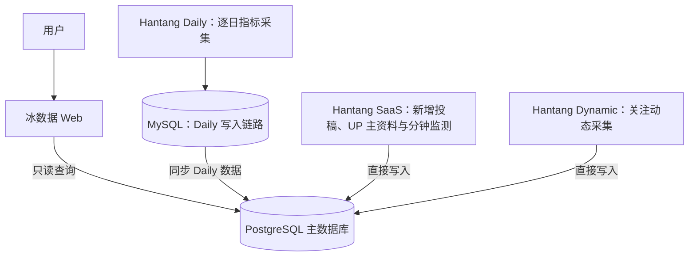

# 冰数据 iceData

冰数据（iceData）是一个致力于构建虚拟歌手社群生态的非官方数据中台组织。我们通过自动化采集、存储和分析虚拟歌手相关的投稿数据，以 Web 应用、智能数据查询和数据可视化视频等形式，为创作者与爱好者提供数据洞察。

- 官方站点：[icedata.top](https://www.icedata.top/)
- GitHub 组织：[icedata-top](https://github.com/icedata-top)
- 飞书组织：`FE0KZ09A1ZE`

## 冰数据 Web：面向用户的交互入口

冰数据 Web 是组织直接面向用户的应用，将歌曲、创作者和虚拟歌手相关数据组织为可搜索、可浏览、可分析的内容。

- **主要功能**：UniSeek 统一搜索，歌曲、创作者与虚拟歌手浏览，投稿详情、历史指标、播放过线记录，以及数据总览和中术50。
- **前端**：React、Vite、Ant Design、React Router、i18next、VChart，支持中文、英文、日文界面。
- **后端**：Java 21、Javalin、Maven，通过 PostgreSQL JDBC 与 HikariCP 提供查询服务。
- **数据访问**：Web 后端只读 PostgreSQL，按查询需要读取明细层或应用层数据。
- **构建与发布**：GitHub Actions 已集成前后端镜像流水线，运行环境通过 Portainer 部署。
- **项目仓库**：[hantang-web-backend](https://github.com/icedata-top/hantang-web-backend)，前后端均在该仓库维护，分别构建和发布。

仓库、包名和部分数据库对象沿用 `hantang` 历史命名，应用名称统一使用“冰数据 iceData”。本项目负责查询接口、展示和应用查询相关的数据设计；数据获取与同步由各自项目独立维护。

## 工程架构

组织的数据链路由独立采集任务、数据库、面向应用的数据加工和用户应用组成。采集任务按职责并行运行，分别获取收录范围内全部投稿的当日观测指标、新增投稿、UP 主资料等数据。

**PostgreSQL 是当前主数据库。** 只有 Daily 保留“先写 MySQL，再同步到 PostgreSQL”的链路；其余采集项目直接写入 PostgreSQL。Web 查询统一从 PostgreSQL 读取数据。

### Hantang Daily：逐日指标采集

- **职责**：面向收录范围内的全部投稿，定期获取当日播放量等观测指标，形成 `video_daily` 逐日快照。
- **指标含义**：快照保存观测时的累计指标；相邻日期快照作差，才能得到对应观测区间的增长量。
- **写入路径**：先写 MySQL，再同步到 PostgreSQL。
- **技术栈**：Java。
- **项目仓库**：[hantang-daily](https://github.com/icedata-top/hantang-daily)。

### Hantang SaaS：新增投稿与 UP 主资料

- **职责**：独立获取新增投稿、UP 主信息等数据，补充和更新投稿基础资料与账号资料；同时承担重点投稿的分钟级指标监测。
- **数据类型**：投稿基础信息、UP 主资料，以及 `video_minute` 等分钟级观测记录。
- **写入路径**：直接写入 PostgreSQL。
- **技术栈**：TypeScript。
- **项目仓库**：[hantang-saas](https://github.com/icedata-top/hantang-saas)。

### Hantang Dynamic：关注动态采集

- **职责**：捕获关注账号发布、转发的新视频动态，补充投稿发现与基础资料。
- **写入路径**：直接写入 PostgreSQL。
- **技术栈**：TypeScript。
- **运行方式**：用户端采集。
- **项目仓库**：[hantang-dynamic](https://github.com/icedata-top/hantang-dynamic)。

各采集项目的采集策略、运行环境和同步维护由对应维护者负责。应用消费这些项目产出的数据，发现源数据缺失时，由对应数据链路修复与补数。

## 数据存储与表分层

### PostgreSQL 与 MySQL 的职责

**PostgreSQL** 承担核心数据存储、应用层结果保存和对外查询，是当前数据平台的主数据库。**MySQL** 仅保留在 Daily 的前置写入与同步链路中，不再承担整个组织主数据库的角色。

数据在 PostgreSQL 内按用途分为**明细层**和**应用层（ADM）**。这是一种逻辑分层，不要求拆分为两个数据库；当前相关对象主要位于 `hantang_dynamic` schema。

### 明细层：基础资料与观测事实

明细层保存采集、同步和基础整理后的投稿资料、账号资料与指标记录，为历史追溯、明细查询和后续加工提供依据。

- **投稿资料**：标题、投稿时间、简介、封面、分区、上传账号等。当前 Web 视频基本信息统一读取 `processed_videos`；历史 `video_static` 不作为缺失时的默认回退来源。
- **账号资料**：UP 主名称、头像、粉丝数、签名及资料更新时间等，当前以 `discovered_users` 为主要来源。
- **逐日指标**：`video_daily` 保存各投稿在观测日期的累计播放、收藏、点赞、硬币、分享、评论、弹幕等指标。
- **分钟与事件记录**：按需采集的 `video_minute` 分钟级指标，以及 `video_collection_gate_crossings` 播放过线事件。

当前数据以视频投稿为主要记录单位。同一首歌曲可以有多个版本或多次投稿，投稿记录数不等于去重后的歌曲作品数；上传账号也不等于完整的创作分工。

### 应用层 ADM：面向业务的结果与关系

ADM 保存基于明细加工、识别、关联或聚合得到的业务数据。它既包括统计结果，也包括供应用直接使用的标签、实体关系和搜索投影，不仅限于汇总表。

主要包括以下几类：

- **UniSeek 搜索宽短表**：`adm_uniseek_videos` 将搜索所需的投稿资料、标签和同一来源日的累计指标集中到一行，只保留当前已发布搜索集，减少在线查询大明细表和多表关联的成本。
- **歌曲打标信息**：是否为歌曲、演唱来源、演唱语言等业务判断，归入 ADM。标注需保留来源、版本、处理状态及必要的复核信息，供歌曲收录、筛选和后续创作者识别复用。
- **歌曲与虚拟歌手的对应关系**：归入 ADM，用于连接投稿与虚拟歌手实体，支持一条投稿关联多个歌手。标准名称、别名和稳定标识需要统一维护，不能仅凭标题提及就认定演唱关系。
- **日粒度聚合**：`adm_entity_metrics_daily` 按业务日期、数据范围和维度对象保存累计指标与日增量，支撑总计、中术50、分区等统计查询。

分层依据是数据用途与加工语义，不能仅凭表名或现有字段的位置判断。歌曲打标和歌手关系按组织设计归属 ADM；当前源表中已有的 `label_*` 字段不代表独立的业务标注与关系体系已经建成。相关表结构、标注覆盖和应用接入仍按各项目进度推进。

### 应用如何使用两层数据

面向用户提供的数据可以来自明细层，也可以来自 ADM。详情和历史观测适合读取明细；搜索、列表筛选和常用统计优先使用按业务整理好的 ADM 数据，以降低实时扫描、关联和计算的成本。

目前 UniSeek 歌曲检索与歌曲列表已读取 `adm_uniseek_videos`，总览接口仍直接查询明细；日聚合表不代表所有统计页面均已完成接入。歌曲打标、可靠的投稿—歌手关系和后续歌手聚合仍待完善。

ADM 的发布需保留来源日期、批次和规则版本。指标缺失应与真实零值区分，刷新失败保留上一成功批次；查询效率的提升不应掩盖来源缺失或改变统计口径。

## UniSeek：统一发现与搜索

UniSeek 将虚拟歌手、歌曲和创作者组织在同一个搜索入口中，支持关键词以及 AV、BV、UID 精确查询。虚拟歌手名称与别名在前端本地匹配，歌曲和创作者分别通过后端查询，结果按到达顺序展示，后续滚动只加载歌曲。

歌曲检索使用已经发布的 ADM 搜索集，避免每次搜索都关联投稿资料与逐日明细。当前搜索集限定来源日累计收藏数严格大于 100 且未删除的投稿；该条件是查询集的筛选规则，不等于投稿已完成歌曲内容核验。内容打标和歌手对应关系完善后，将进一步支撑更准确的收录与发现。

## ChatBI 与数据查询能力规划

### 既有 ChatBI：停止维护

既有 Hantang ChatBI 是基于自然语言的数据查询项目，历史技术栈包括 Java、Spring Boot，以及 Dify 与 Qwen turbo 工作流。该项目已停止维护，后续智能查询能力不再沿用 Dify Workflow 方案。

### 后续方向：ReAct、Planning & Decision 与 MCP Server

新的智能查询方向采用 **ReAct** 与 **Planning & Decision**：围绕用户问题规划查询步骤、选择数据与工具，根据执行结果继续决策，再组织回答。

数据查询能力将抽取为可复用的 **MCP Server**，向 ChatBI 及其他支持 MCP 的客户端提供统一工具。歌曲与创作者检索、指标查询和聚合分析等能力可以复用同一套数据口径，按需要访问 PostgreSQL 的明细层或 ADM。

以上为后续规划，不代表新的 ChatBI 或 MCP Server 已经上线。

## 历史内容与工具

### 统计月报：停止维护

- 历史技术栈：Java、MySQL。
- 历史资料：[Bilibili 专栏文集](https://www.bilibili.com/read/readlist/rl68394)。
- 历史仓库：[Icedata_Monthly_Statistical_Report](https://github.com/JingyuNankin/Icedata_Monthly_Statistical_Report)。

### 洛天依新曲排行榜：低维护

- 技术栈：Python。
- 视频资源：[Bilibili 合集](https://space.bilibili.com/67946083/channel/collectiondetail?sid=1364628)。
- 项目仓库：[Gitee 仓库](https://gitee.com/icedata-foundation-frame/luotianyi-weekly-ranking)。

### 添加监测任务工具

历史工具：[hantang-add](https://github.com/icedata-top/hantang-add)，访问入口：[添加监测任务](http://hantang-add.streamlit.app)。它是独立的监测任务工具，当前冰数据 Web 的前后端代码在 `hantang-web-backend` 仓库维护。

## 域名与基础设施

- **组织域名：`icedata.top`。** 官方站点使用 [www.icedata.top](https://www.icedata.top/)。
- **服务器共两台：阿里云一台、雨云一台。** 用于承载组织的采集、数据服务与应用，具体服务分配由各项目维护者管理。
- **发布网络**：使用 Tailscale，以已获授权的 GitHub 账号登录，选择 `icedata-top.org.github` 并连接网络。
- **容器管理与发布**：[Portainer](http://portainer.icedata.top/)，连接发布网络后使用具备权限的账号访问。
- **冰数据网盘**：基于 Cloudreve，为组织提供内部文件共享与协作服务。
